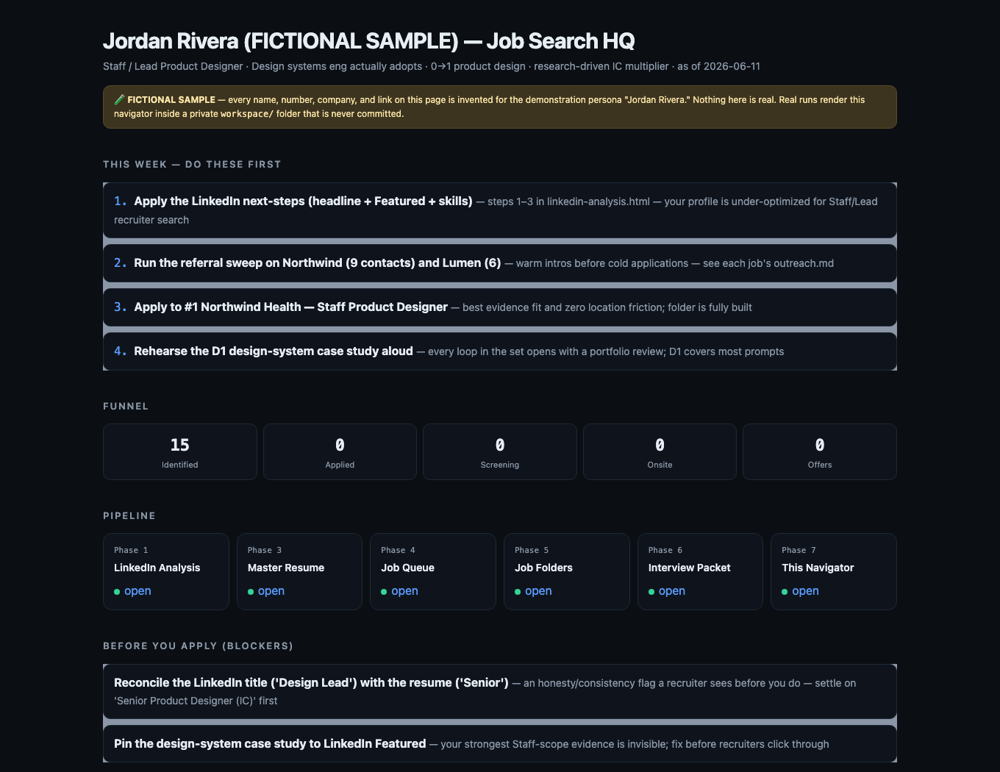
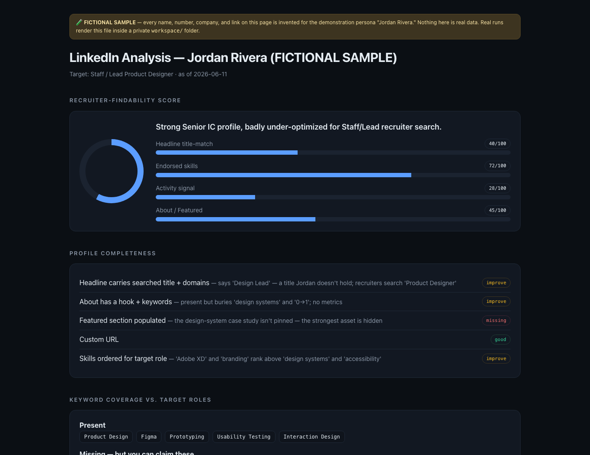

<div align="center">


# An evidence-grounded job-search pipeline for Claude Code

**Point it at your LinkedIn export and resume. Get a ranked queue of live jobs with explainable fit
scores, a tailored one-page PDF per application, referral-first outreach, and interview prep, all
built from your real career history.**


&nbsp;
&nbsp;
&nbsp;

[**See a full fictional run**](examples/sample-run/) · [Quickstart](#quickstart) · [How it works](#how-it-works) · [How people use it](WORKFLOW.md) · [Non-coder setup](docs/SETUP.md)

</div>

<!-- DEMO: record a 10–15s clip of `/ascend` → intake → a phase completing → opening start-here.html.
     Export GIF ≤8MB ≤1200px wide → commit to assets/demo.gif → replace this comment with:
     <div align="center"></div> -->

Job hunting with AI has a trust problem: generic ChatGPT résumés are the new typos, and recruiters
flag them on sight. Ascend takes the opposite bet. It builds everything from **your** LinkedIn
export, **your** résumé, and **your** answers, then runs a linter that mechanically blocks invented
numbers, retracted claims, and AI-tell language before anything is called done. A missing skill
becomes an honest gap with a plan. Never a bluff.

It runs entirely inside [Claude Code](https://claude.com/claude-code) on your machine. Your data
lands in a gitignored `workspace/`, and nothing about you is ever committed.

## What it looks like

Two of the dashboards it builds, from the committed fictional sample (open them yourself in
[`examples/sample-run/`](examples/sample-run/), no install needed):

| `start-here.html`, your home base | `linkedin-analysis.html`, the profile audit |
|---|---|
|  |  |

## Quickstart

```bash
git clone https://github.com/koushik1610/ascend.git
cd ascend
claude        # open Claude Code here
```

Then type **`/ascend`**. It interviews you (name, where your LinkedIn export and résumé live, what
jobs you want), builds a private `workspace/<your-name>/`, and runs the pipeline with a check-in
after each phase. When it finishes, open **`workspace/<your-name>/start-here.html`** and work the
"Before you apply" blockers and your #1-ranked job.

Three useful variants:

- **Sample it cheap first:** say *"Run Ascend Phase 1"* for just the LinkedIn audit.
- **Prefer clicking to typing:** run **`/ascendui`** *(beta)* for a browser console with a folder
  picker and live progress. See [`ui/README.md`](ui/README.md).
- **Never opened a terminal?** [`docs/SETUP.md`](docs/SETUP.md) walks you in step by step.

## What you get

| Output | What it is |
|---|---|
| `linkedin-analysis.html` | Visual audit of your LinkedIn presence: findability score, keyword gaps, network reach, plus **10 ranked next steps**. |
| `master-resume.md` | Your superset résumé. Every achievement, tagged and ID'd, with a metrics bank. Per-job résumés are *selected* from it, never rewritten. Also rendered to a generic public PDF. |
| `job-queue.md` | Cast wide (40–60), **triage cheap**, then score the survivors properly. A live queue of up to 8, each with an explainable 0–100 Fit Score and a "why you'd lose this one" line. Links are fetched and honestly marked verified or unverified. |
| `reviews/week-NN.md` | The weekly review: what you did, what moved, your funnel in your own numbers, and exactly one decision. A search dies from attrition, not from a bad résumé. |
| `jobs/<NN-company-role>/` | An apply pack per job: tailored résumé (markdown + `resume.json` + a clean one-page **ATS-safe PDF**), referral-first outreach, application log with a referral hard gate. |
| `interview-packet/` | Cross-job prep: STAR stories, positioning hooks, metrics cheat-sheet. Deep per-job prep is built **when a screen books**, not speculatively. |
| `start-here.html` | The front door: weekly action loop, application funnel, every job. **Open this first.** |

The default first run is lean by design, roughly 25–30 files. Intake asks whether you want packs
for the top 3–5 jobs you commit to, or the full queue. A run manifest (`.ascend-state.json`) makes
everything resumable: close your laptop mid-run, say *"Run Ascend resume"* later, lose nothing.

## How it works

```
  0  Intake interview ......... your name, data paths, targets, honest gaps
  1  LinkedIn analysis ........ linkedin-analysis.html + 10 next steps
 26  Industry language ........ how your target level writes about its work (reused if built this month)
  3  Master resume ............ master-resume.md (audit folded in) → LOCK IT
  4  Job search ............... triage 40-60 cheap → Fit-Score the survivors → queue of 8
 11  Network map .............. who you already know, primary + fallback per company
  6  Interview packet ......... thin now, enriched on demand
  5  Apply packs .............. résumé · outreach · log (+ one-page PDF each)
  7  Navigator ................ start-here.html

  then, every week ........... /ascend log as things happen · /ascend week to review
```

The engine behind the quality is one idea: **lock the master, then only select.** Once you approve
your master résumé, it freezes. Every downstream résumé reorders and trims locked bullets, cited by
ID in a delta log. A job that needs a bullet you don't have produces a MASTER GAP note, and the fix
happens at the source. That is what makes tailoring fast and fabrication structurally hard.

**Launching a search is not running one.** Everything above gets you to your first applications; what
happens over the next three months decides the outcome. So the pipeline ends in a loop rather than a
handoff: `log` captures each event as it happens, the daily brief reads that to nudge what's actually
due, and the weekly review counts what you did, shows your funnel in your own numbers, and asks for
exactly one decision. It reports counts rather than conversion rates until you have enough
applications for a rate to mean anything, and it never offers a verdict about you.

Five mechanical gates back it up:

1. **The linter** ([`tools/lint_artifacts.py`](tools/lint_artifacts.py)) scans every sendable for
   em-dash tells, [banned AI vocabulary](.claude/banned-words.md), your forbidden internal numbers,
   retracted claims, and delta-log provenance. Zero findings or it isn't done.
2. **The honesty rules** ([`reference/number-and-honesty-policy.md`](reference/number-and-honesty-policy.md))
   ban invented metrics, titles, certs, and referral contacts outright. "Why this company" essays
   come out as outlines for your voice, never finished prose.
3. **The untrusted-content quarantine** ([`reference/untrusted-content-policy.md`](reference/untrusted-content-policy.md)):
   anything fetched from the web is data to analyze, never instructions to obey, backed by an
   allow-list-only **Bash** boundary. `Read` stays broad, since the pipeline reads arbitrary résumé
   locations. `WebFetch` asks you before every fetch, so a page or email that asks for one still needs
   your yes (unless you run Claude Code in bypass-permissions mode, which skips every question).
4. **Output-path confinement** ([`tools/_paths.py`](tools/_paths.py)) makes "writes only under
   `workspace/`" true for tools, not just for the agent's Write tool. (The agent may also write the
   anonymized, shared `industryresearch/` reference; see below.) The Bash allow-list pins a tool
   by path prefix and constrains none of its arguments, so `render_resume.py --tex /anywhere` used to
   write outside the repo. Every tool now resolves its output path before using it, and `--engine`
   accepts only a known TeX binary rather than anything on `PATH`.
5. **The run grader** ([`tools/grade_run.py`](tools/grade_run.py)) turns the v1.0 sign-off rubric into
   something a machine checks: every delta-log ID resolves to a real master entry, gaps are declared
   rather than quietly filled, sendables pass the linter, the expected artifacts exist, and nothing
   personal is git-tracked. CI grades the committed sample with the same code that grades your run, so
   the example and the standard cannot drift apart. It reports *no detectable fiction* — never
   "verified true," which no tool can claim.

### Industry language research

Before writing your master résumé, Ascend checks how people already at your target level, in your
field, describe their work. Phase 26 ([`prompts/26-industry-language.md`](prompts/26-industry-language.md))
reads 30 to 50 profiles (LinkedIn through your own browser if you connect it, otherwise public bios and
pages, plus a few postings) and writes a phrasing reference: what strong profiles do that weak ones
don't, bullet templates, level vocabulary for IC and leadership tracks, a verb bank, and keyword
clusters with honest counts.

```
industryresearch/
  README.md
  tech/cloudsecurity/industry-language.md        ← shipped example (49 profiles, Oct 2026)
  media/journalism/industry-language.md          ← built the first time a journalist runs Ascend
  finance/investmentbanking/industry-language.md ← and so on, one folder per industry/domain pair
```

- **Monthly, shared, and skipped when fresh.** Every run calls
  `python3 tools/industry_research.py status <industry> <domain>`. If the file was built this calendar
  month the run reuses it in seconds. Otherwise it rebuilds it. The industry and domain come from your
  intake, so a finance or journalism user gets their own field's reference, not a security engineer's.
- **Phrasing, never facts.** Phases 3, 5 and 18 use it to choose how to say something true. What is
  true still comes only from your evidence. Your personal mapping against it (which clusters you can
  claim, which are gaps) goes to `workspace/<name>/industry-fit.md`, never into the shared file.
- **Anonymized.** No names, no profile URLs, no employer attached to a person's career path, and
  phrases are short fragments rather than copied bullets. See [`industryresearch/README.md`](industryresearch/README.md).
- **The one shared write.** This folder is the only place a run writes outside `workspace/`, through a
  scoped `Write(industryresearch/**)` permission. Whether to commit a refreshed file back is your call:
  it holds no personal data by construction.

First master résumé draft feeling weak? That is the system working: the bullet-quality gate flags
weak bullets and tells you what evidence would fix them. Expect one revision pass. The iteration is
where the quality comes from.

## Ascend 2.0 (beta): find, apply, track

Version 1 builds the apply packs. Version 2 keeps the search running: it finds matching roles every day,
prepares the applications you approve, and reads your inbox to track what happened, all on your machine.
By default you submit every application yourself. If you turn on automatic apply in the hub, a runner on
your Mac submits Greenhouse, Ashby and Lever applications for you, within limits you set.

```
  every day, zero tokens      finder (public ATS boards) → prefilter → alerts → Gmail sync → classify → ledger → hub
  when you run it             score the survivors (Phase 27) → you approve → apply (Phase 28) → hub
  automatic apply (opt-in)    daily sync → runner submits ready Greenhouse/Ashby/Lever jobs → Needs you for the rest
```

**You choose the engine per run, and see the token estimate and the permissions before anything is spent**
(`python3 tools/run.py plan workspace/<you> --engine A`):

| Engine | How it gathers | Setup |
|---|---|---|
| **A** deterministic core | Python reads the job boards and your Gmail (your own Google sign-in, read-only) | a Google Cloud OAuth client, once ([docs/GMAIL-SETUP.md](docs/GMAIL-SETUP.md)) |
| **B** agent-driven | Claude does every stage, including web search | none, but the most tokens |
| **C** core + connector | Python reads the boards; Claude reads Gmail through the claude.ai connector | none |

**Applying by hand.** For each job you approve, the hub shows an apply sheet: the answers to copy, the
résumé to attach and the application link. You submit and press **I submitted it**. The sheet is built only
when the job is approved, it is not a duplicate, its résumé passes the linter, and every answer comes from
your own files.

**Automatic apply (opt-in, beta).** Turn it on in the hub's Queue tab by typing "apply for me". From then
on the daily sync runs `tools/autoapply.py`, which opens each ready job's application page in a headless
browser (Playwright: `pip install playwright && playwright install chromium`), fills it and submits it.
- **Ready** means: on a Greenhouse, Ashby or Lever board in your `sources.json`, fit at or above your
  threshold (default 75), passed your rule filter, a tailored résumé that passes the linter, not a
  duplicate, and fewer than 2 applications to that company in 30 days. A job folder from an earlier run that
  you left unsent goes only after you approve it. The page is rebuilt from the board, never taken from a link
  in a posting or an email.
- **Answers** come only from files you write: `data/profile.json`, `data/apply-answers.json` (work
  authorization, sponsorship, salary, start date, demographic choices) and `data/answer-bank.json` (your
  own answers to recurring questions, matched by their wording). Claude cannot write the last two. Essays,
  legal agreements and company-specific questions are never answered from anything else, so a form that
  requires one stops.
- **Stops go to Needs you** with the reason: a visible CAPTCHA, a sign-in page, a question your answers do
  not cover, no confirmation page. A job is marked applied only when the confirmation page appeared, with
  screenshots in the job folder. Claude can fill stopped jobs with you in a session and submits only after
  your yes for that batch.
- **Limits:** 5 a day for the first week, then your cap (default 25); pause and resume in the hub; it
  pauses itself after 3 unclear results in a day, or when fewer than 5% of your last 50 applications got
  any reply.
- **Risks you accept:** some job boards' terms forbid automated applications, and every form carries a
  bot check. Ascend does nothing to get past one: a visible challenge stops the job and an invisible one
  decides on its own, so some submissions may be rejected. A wrong saved answer repeats on every form until
  you fix it. Workday and Eightfold jobs are found and tracked, never submitted automatically.

**What you are granting, per engine.** `run.py plan` prints this list every time.

| | Engine A | Engine B | Engine C |
|---|---|---|---|
| Gmail | Your own Google OAuth client, `gmail.readonly` scope. Ascend cannot send, change or delete mail. The token stays in your macOS Keychain. | Claude reads your mail through the claude.ai Gmail connector. | Same as B. |
| Gmail write tools | Not requested. | Denied in this repo's `.claude/settings.json`: send, reply, forward, drafts, labels, spam, trash. | Same as B. |
| Google Drive | Not used. | Share, create, update, copy and trash are denied. | Same as B. |
| Web | Public job-board APIs, read only. | Public boards plus Claude's web searches. | Public job-board APIs, read only. |
| Web page fetches | Ask you every time. | Ask you every time. | Ask you every time. |
| Applications | Submitted only by the runner after you turn automatic apply on in the hub, or by Claude in Chrome after your yes for a batch. Claude in Chrome's scripting, shortcut, image-upload and batch tools are denied; form filling and file upload are allowed, so keep its per-action prompts on. | Same as A. | Same as A. |
| Approve, "I submitted it", automatic apply | Your click in the hub, with a confirm (and a typed phrase to turn automatic apply on). Claude's file tools cannot edit the queue, the apply log, `auto.json` or your answer files. | Same as A. | Same as A. |

Engines B and C search Gmail with a query limited to job senders and job subjects: 30 days on the first
read, then from the day before the last read. Your own sent mail is never stored, but a thread Claude opens
still shows your replies in that session. The mail Claude reads is untrusted, and
the same session can fetch web pages. Claude treats mail as data, and this repo's settings ask you before
every web fetch, so a fetch an email asked for still needs your yes. Deny beats ask beats allow, so a
narrower allow in a local file cannot skip that question. On engine C, which never needs a fetch, you can
add `"deny": ["WebFetch"]` to your own `.claude/settings.local.json` (that also stops the v1 research
prompts from fetching pages in this checkout). A deny in this
repo's `.claude/settings.json` cannot be reopened from a local file: to let Claude draft mail here, remove
the entry from `.claude/settings.json` itself. **LinkedIn search** is opt-in on
every engine. It drives your own logged-in LinkedIn session through Claude in Chrome and reads result
cards only. Automated browsing can break LinkedIn's terms of use and put the account at risk, so Claude
asks before each search.

**First run.** After a v1 run, `/ascend run-v2` sets up two files with you: `data/profile.json` (the only
answers an apply sheet pre-fills; Claude asks for your contact details and shows you the file) and
`data/sources.json` (the company boards to watch and your filters). `run.py plan` will not start until both
exist. Each board is found with `python3 tools/finder.py probe "Company"`, because a guessed slug fails
quietly: on the first from-scratch run, 30 of 127 hand-listed boards were wrong. Companies on Workday or
Eightfold (Netflix) are found with `python3 tools/finder.py probe --careers <careers page URL>`; companies on
Phenom, iCIMS or their own career sites cannot be watched. Your job folders from the v1 run join the queue
(`jobqueue.py sync`), so their mail is tracked and their roles are not scored again, and Claude asks which
of them you already sent. Restart `python3 ui/server.py` after updating Ascend: the server keeps the tool
code it started with.

**The hub** (`python3 tools/hub.py build workspace/<you>`, or served with actions at `/hub?slug=<you>`)
shows the funnel from found to offer, this week's applications, replies and interviews, the mail
waiting on you with its due date, a queue you approve from, a classified inbox, and token spend by
stage. **`python3 tools/schedule.py install workspace/<you> --at 06:30`** runs the zero-token part every
morning (cron skips the run if the Mac is asleep at that time). It also deletes mail older than 180 days
from the workspace and keeps only the headers of mail that is not about a job.

What has run on real data and what is still beta: [docs/V2-READINESS.md](docs/V2-READINESS.md).

## Day-to-day

| Say this | What happens |
|---|---|
| `/ascend` | Full run from the intake interview |
| `"Run Ascend Phase 1"` | Just the LinkedIn audit, a cheap first taste |
| `"Run Ascend resume"` | Continue an interrupted run from the manifest |
| `"Ascend export Acme"` | Render a job's résumé to a one-page ATS-safe PDF |
| `"Ascend prep 03"` *(beta)* | Deep interview prep for job #3 when a screen books |
| `"Ascend today"` *(beta)* | Daily briefing: 3 actions + follow-up nudges, drafted |
| `"Ascend network"` *(beta)* | Who you already know at each target company |
| `"Ascend log 03 applied"` *(beta)* | **Record what actually happened.** One command, and every number downstream updates |
| `"Ascend week"` *(beta)* | The 15-minute weekly review: count, capture, calibrate, decide one thing |
| `"Ascend rejected 03"` *(beta)* | Close out a rejection in 90 seconds and activate a named replacement |

**`log` is the one worth making a habit.** The daily brief, the funnel, the follow-up nudges and the
weekly review all read from it. Before it existed, the only way to record that you had applied was to
open a markdown file and hand-edit a date, so those fields stayed empty and the ghost detector was
reading nothing.

<details>
<summary><b>All commands (including the beta ops)</b></summary>

| Say this | What it does |
|---|---|
| `/ascendui` *(beta)* | Browser console: intake wizard, live progress, daily-brief scheduling |
| "Ascend job add \<url>" *(beta)* | Add + build an apply pack for a job you found |
| "Ascend score \<paste a JD>" *(beta)* | 0–100 Fit Score + missing keywords, no files built |
| "Ascend answers" *(beta)* | Reusable, varied answers to application questions |
| "Ascend build-resume" *(beta)* | Standalone résumé builder (form + live preview + PDF) |
| "Ascend export-docx Acme" *(beta)* | ATS-safe Word copy via pandoc; PDF stays the default |
| "Ascend aggregate" *(beta)* | Pull open roles from Greenhouse/Lever/Ashby public boards |
| "Ascend crm" *(beta)* | Keep warm referral relationships alive |
| "Ascend mine" *(beta)* | Guided interview that extracts real wins into the master |
| "Ascend drill 03" *(beta)* | Live mock interview with evidence-grounded feedback |
| "Ascend degenericize" *(beta)* | Swap generic text for your real evidence |
| "Ascend negotiate Acme" *(beta)* | Salary plan: market anchors, your numbers, scripts |
| "Run Ascend maintenance" *(beta)* | Weekly: new/closed jobs, follow-ups due, retro patterns |
| "Ascend industry" *(beta)* | Rebuild or inspect the phrasing reference for your field (runs monthly by itself) |
| "Ascend run-v2" *(beta)* | Ascend 2.0 run: choose an engine, see the token estimate and permissions, find, score, track |
| "Ascend apply" *(beta)* | Apply: automatic for Greenhouse, Ashby and Lever once you turn it on, an apply sheet for the rest, Claude helps with stopped jobs after your yes |
| "Ascend linkedin-search" *(beta)* | LinkedIn Jobs in your own browser, result cards only |
| "Ascend hub" *(beta)* | The live dashboard: funnel, queue with approve and apply, inbox, token spend |
| "Ascend schedule" *(beta)* | Run the zero-token daily sync on a schedule |
| "Ascend titles" *(beta)* | Job titles your own evidence already supports, that you aren't searching for |
| "Ascend offers" *(beta)* | Compare offers component by component, read the letter, work the timeline |
| "Ascend work-sample" *(beta)* | The portfolio piece or take-home that decides the loop: build one, re-angle per job |
| "Ascend references" *(beta)* | A consent-tracked reference bench, plus the brief that changes the call |

Who uses each command, when, and with what preconditions lives in
[`WORKFLOW.md`](WORKFLOW.md).
</details>

### You can also just ask

The fifteen files under [`.claude/skills/`](.claude/skills) make the common tasks reachable without
knowing a command. Say *"is my résumé ATS friendly"*, *"should I apply to this"*, *"is 120k good"*,
*"I got two offers"*, *"they asked for references"*, *"they ghosted me"*, and Claude Code loads the
matching skill, which hands it the canonical phase prompt and the shared rules in
[`reference/`](reference).

They are deliberately **thin**: a trigger surface and a pointer, never a copy of the rules. Ascend's
honesty gates, bullet formula and banned vocabulary live in one place each, and a skill that restated
them would be the copy nobody updates. `tests/smoke.py` enforces each of those properties — a closed
YAML frontmatter block with a `name` matching its directory, three or more quoted trigger phrases, a
prompt file that exists plus an imperative to *read* it, the preconditions a cold trigger has to check
before producing anything, both policy files referenced, no line of canonical rule text restated
verbatim, and 80 lines maximum.

**The objective is action, not paperwork.** The dashboard leads with a weekly *apply N / ask N
referrals* loop and a funnel scoreboard. Applications sent and referrals asked get you interviews.
The documents are ammunition.

## Honest status

**Who this is actually for:** someone targeting a handful of specific roles who wants each application
done well, has (or will get) Claude Code access, and doesn't mind spending an hour of agent time per
run. **Who should look elsewhere:** anyone optimizing for application volume, without token/subscription
budget to spare, or without an hour free per run: see Costs below before you start.

**v0.6.0, working toward 1.0.** The `/ascend` text pipeline is the stable core. The graphical
console, the scheduled daily brief, and the on-demand ops marked *(beta)* are built and code-checked
but not yet exercised end-to-end on real data. The 1.0 tag waits on archived real runs with
line-by-line honesty sign-offs. Progress and the sign-off log live in
[`docs/ROADMAP.md`](docs/ROADMAP.md).

<details>
<summary><b>Costs & requirements</b></summary>

- **You need a Claude subscription or API access.** This runs inside Claude Code and uses tokens.
- **A full run is long.** Live research on 15+ roles plus the generated files means 1–3+ hours of
  Claude working, across several check-ins. Sample Phase 1 first.
- **It isn't free.** Expect a full run to consume a large share of a Pro plan session limit or
  several dollars of API usage. If you hit a limit mid-run, nothing is lost: *"Run Ascend resume"*
  when it resets.
- **PDF rendering is automatic** via headless Chrome. No Chrome-class browser? You get a two-click
  "Save as PDF" fallback.
- **Platform:** macOS and Linux. On Windows use WSL or Git Bash ([`docs/SETUP.md`](docs/SETUP.md)).
</details>

<details>
<summary><b>Privacy model</b></summary>

Everything personal lives in `workspace/<name>/`, which is gitignored: your LinkedIn export,
résumés, job folders, dashboards. The `.gitignore` also blocks résumé-shaped files and standard
LinkedIn export names elsewhere in the tree as a backstop (a renamed export outside `workspace/` is
only caught by the `workspace/` rule, so keep exports there). Both dashboards carry a "personal
data, keep it local" banner. Run it for a friend and they get their own folder. Delete a folder to
wipe that person entirely. Data goes to whichever agent CLI is running the pipeline (Claude Code by
default) and nowhere else, and web access is read-only research. **One exception:** the opt-in daily
brief (off by default) can fall back to Gemini CLI or Codex CLI if that's what it finds. In that
case your data goes to that provider instead for the briefing, without this repo's Claude-Code-specific
permission settings backing it up. See [`ui/README.md` → The daily brief](ui/README.md#the-daily-brief).
</details>

<details>
<summary><b>FAQ</b></summary>

**Will it apply to jobs for me?** Only if you turn on automatic apply in the hub (Ascend 2.0, beta), and
only on Greenhouse, Ashby and Lever, from answers you wrote yourself. Otherwise it finds, tailors and preps,
and you submit. Automated applications break some sites' terms, and every form carries a bot check that
may reject them: read the risks in the Ascend 2.0 section before turning it on.

**Are the job links real?** Phase 4 fetches each link and marks it verified or unverified, and
never invents req IDs. Career sites block bots and postings rot, so the queue reports the honest
split and you re-open every link before applying.

**Can it run without a résumé?** Yes. It builds the master from your LinkedIn export plus the
intake interview.

**Why not just use ChatGPT?** A chat session has no memory of your evidence, no provenance, and no
gate against invention. Ascend's whole architecture exists to make "sounds plausible" insufficient.

**Can I customize it?** Yes. Everything is Markdown in `prompts/`, `templates/`, and `reference/`.
</details>

<details>
<summary><b>Known limitations</b></summary>

- **Beta surfaces** are labeled throughout and stay beta until real runs prove them.
- **`/ascendui` needs its terminal to stay open.** The browser console shows live progress, but the
  Claude Code (or gemini/codex) session you launched it from is what actually runs the pipeline. Close
  that terminal, and the console can't tell you it stopped, just that nothing new has arrived. It now
  says so if progress stalls. Reopen the terminal and say *"Run Ascend resume"* to continue.
- **Scheduled daily brief** runs your agent CLI headlessly via cron (macOS/Linux, off by default,
  opt-in). If a scheduled run doesn't complete, *"Ascend today"* gives the same briefing. Its
  prompt-injection quarantine is backed by this repo's permission settings only when run via `claude`;
  the `gemini`/`codex` fallback relies on the prompt text alone (see `ui/README.md`).
- **Free tiers:** a free web-chat tier can't read local files. You need a local agent CLI.
- **Tests** cover the server, dashboards, gitignore, permissions, linter, and cross-refs. There is
  no full end-to-end test. That requires a real run, which is exactly what gates 1.0.
</details>

<details>
<summary><b>Repo map</b></summary>

```
ascend/
├── README.md · WORKFLOW.md · CLAUDE.md · CHANGELOG.md · LICENSE (MIT)
├── .gitignore                       privacy backstop (all personal data + output ignored)
├── .claude/commands/                the /ascend and /ascendui slash commands
├── prompts/                         the pipeline: 00-orchestrator + phases 01–19
├── templates/                       job folder spec, master résumé, dashboards, résumé builder
├── reference/                       binding rules: ATS, résumé writing, honesty, interview prep
├── tools/lint_artifacts.py          the honesty + language gate
├── ui/                              the graphical console (Python stdlib server)
├── tests/smoke.py                   stdlib smoke tests, wired into CI
├── examples/sample-run/             the complete fictional example
└── workspace/                       YOUR private output (gitignored)
```
</details>

## Contributing

Ascend is a prompt-and-template system. Most contributions are Markdown, plus occasional HTML/JS in
the dashboard templates.

**The one hard rule: never commit personal data.** No real résumés, exports, names, or generated
runs, ever. Anything real lives in `workspace/` (gitignored), and any committed example must be 100%
fictional and live under `examples/`. Before a PR:

```bash
git status --porcelain                              # nothing personal staged
git check-ignore workspace/you/master-resume.md     # prints the path (ignored) = good
python3 tests/smoke.py                              # stdlib + git, no installs; CI runs the same
```

Principles to preserve: honesty gates (nothing fabricated, conviction essays stay outlines) ·
selection over invention · self-contained offline dashboards · field-agnostic · person-agnostic.
Good first contributions: field packs for non-tech roles, keeping
[`reference/ats-and-keywords.md`](reference/ats-and-keywords.md) current, dashboard polish, and
Windows onboarding in [`docs/SETUP.md`](docs/SETUP.md).

---

<div align="center">

**MIT** · [`LICENSE`](LICENSE) · Use it, fork it, run it for your friends and family.

*Built with the same rules it enforces: this README passes `tools/lint_artifacts.py`.*

</div>
