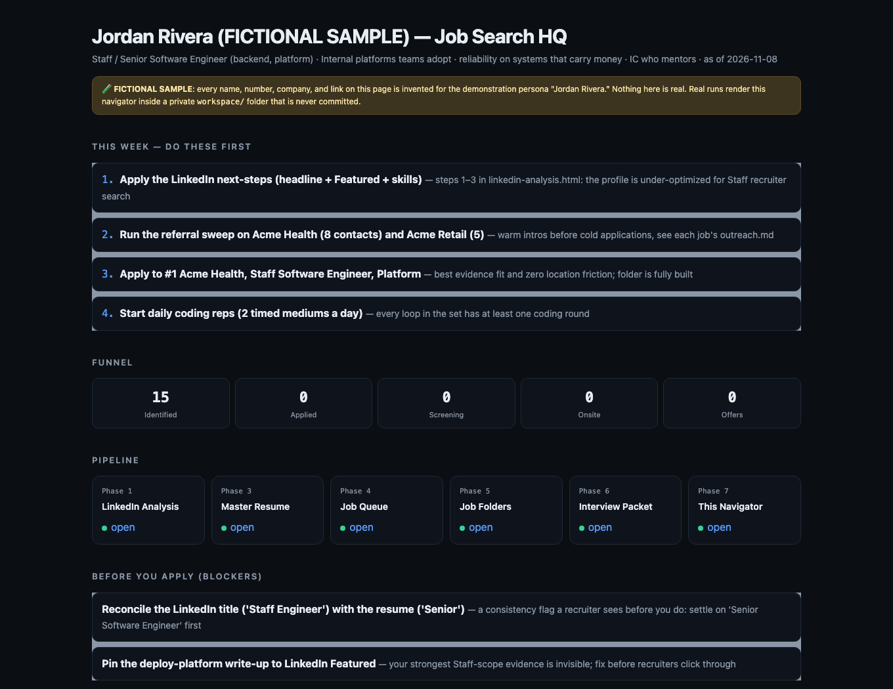
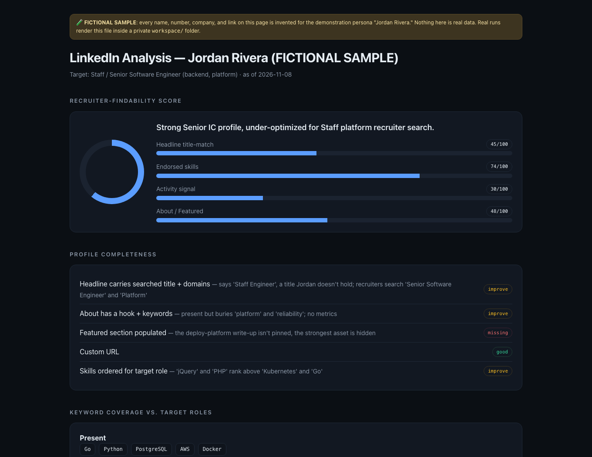

<div align="center">


# Ascend

**An evidence-grounded job search that runs inside Claude Code.**


&nbsp;
&nbsp;
&nbsp;

[Quickstart](#quickstart) · [How it works](#how-it-works) · [Sample run](examples/sample-run/) · [Changelog](CHANGELOG.md)

</div>

## What it does

You give Ascend your LinkedIn export, your résumé and the jobs you want. It gives you back:

- an audit of your LinkedIn profile with ten ranked fixes
- a master résumé holding every real achievement, each with an ID
- a ranked queue of live jobs, each with a 0–100 Fit Score you can read the reasons for
- per job: a tailored one-page PDF, referral-first outreach and an application log
- interview prep when a screen books, and a weekly review that keeps the search moving

Everything comes from your own history. A linter blocks invented numbers, retracted claims and
AI-sounding language before anything counts as done. A skill you lack shows up as an honest gap,
never a bluff. Your data stays in a gitignored `workspace/` folder on your machine.

| `start-here.html`, your home base | `linkedin-analysis.html`, the profile audit |
|---|---|
|  |  |

## Quickstart

```bash
git clone https://github.com/koushik1610/ascend.git
cd ascend
claude        # open Claude Code here
```

Type **`/ascend`**. It interviews you, builds `workspace/<your-name>/`, and runs the pipeline with a
check-in after each step. When it finishes, open `workspace/<your-name>/start-here.html`.

- **Try it cheaply first:** say *"Run Ascend Phase 1"* for the LinkedIn audit alone.
- **Prefer a browser:** `/ascendui` *(beta)* opens a local console with a folder picker
  ([ui/README.md](ui/README.md)).
- **New to the terminal:** [docs/setup.md](docs/setup.md) walks you through it.

## How it works

A first run takes these steps, in this order. Each one is a prompt in [`prompts/`](prompts/),
numbered as in the Prompt column.

| Step | Prompt | What happens | You get |
|---|---|---|---|
| Intake | `00` | A short interview: your name, where your files are, target roles, honest gaps | `intake.md` |
| LinkedIn analysis | `01` | How findable you are, the keywords you're missing, your network reach | `linkedin-analysis.html` |
| Industry language | `26` | How people at your target level describe their work. Reused if built this month | a shared phrasing reference |
| Master résumé | `03` | Every achievement, tagged and ID'd, weak bullets flagged. **You approve it and it locks** | `master-resume.md` |
| Job search | `04` | Casts wide (40–60 roles), triages cheaply, scores the survivors | `job-queue.md` (top 8) |
| Network map | `11` | Who you already know at each company | `network-map.md` |
| Interview packet | `06` | STAR stories, positioning hooks, a metrics cheat-sheet | `interview-packet/` |
| Apply packs | `05` | For your top 3–5 jobs: a résumé selected from the master, outreach, a log | `jobs/<NN>/` + PDF |
| Navigator | `07` | One page with the week's actions, your funnel and every job | `start-here.html` |

**Lock the master, then only select.** Every per-job résumé reorders and trims locked bullets and
cites them by ID. A job that needs a bullet you don't have produces a `MASTER GAP` note, and the fix
happens in the master. That keeps tailoring fast and makes fabrication hard.

**After the first run,** the search is a loop:

- `log` records what happened to each application
- `today` gives a daily brief with the follow-ups that are due
- `week` is a 15-minute review that ends in one decision

Deep interview prep, mock interviews, cover letters and salary plans run on demand. The optional
daily automation finds new roles, prepares the ones you approve and reads your inbox
([docs/automation.md](docs/automation.md)).

A run is resumable. Close your laptop halfway through and say *"Run Ascend resume"* later.

## Commands

| Say this | What happens |
|---|---|
| `/ascend` | A full run, starting with the intake interview |
| `Run Ascend Phase 1` | Just the LinkedIn audit |
| `Run Ascend resume` | Continue an interrupted run |
| `Ascend export Acme` | Render a job's résumé to a one-page ATS-safe PDF |
| `Ascend prep 03` | Deep interview prep for job 03 once a screen books |
| `Ascend log 03 applied` | Record an event. The brief, funnel and weekly review all read from it |
| `Ascend today` / `Ascend week` | The daily brief / the weekly review |

The full list, with who uses each command and when, is in [docs/workflow.md](docs/workflow.md). You
can also just ask: *"is my résumé ATS friendly"*, *"should I apply to this"*, *"I got two offers"*.
The skills in [`.claude/skills/`](.claude/skills) route plain questions like these to the right
prompt.

## The safeguards

| Safeguard | What it does |
|---|---|
| [Linter](tools/lint_artifacts.py) | Blocks AI-tell punctuation, [banned words](.claude/banned-words.md), your forbidden numbers, retracted claims and keywords no bullet backs. Zero findings or it isn't done |
| [Honesty policy](reference/number-and-honesty-policy.md) | No invented metrics, titles, certifications or referral contacts. "Why this company" answers are outlines you finish yourself |
| [Untrusted-content quarantine](reference/untrusted-content-policy.md) | Web pages, postings and email are data, never instructions. Bash is allow-list-only and every web fetch asks you first |
| [Path confinement](tools/_paths.py) | Tools write only under `workspace/`, whatever arguments they're given |
| [Run grader](tools/grade_run.py) | Checks a finished run: every ID resolves, gaps are declared, nothing personal is tracked. CI grades the sample the same way |

## Status and costs

**v0.6.0, working toward 1.0.** The `/ascend` pipeline is the stable core. Anything marked
*(beta)* is built and tested but has not run on enough real searches yet. Progress lives in
[docs/roadmap.md](docs/roadmap.md).

- **Who it's for:** someone targeting a handful of specific roles who wants each application done
  well. Not for maximizing application volume.
- **Cost:** it runs on Claude tokens. A full run is 1–3 hours of agent time and a large share of a Pro
  plan session. If you hit a limit, nothing is lost: resume when it resets.
- **Platform:** macOS and Linux. On Windows use WSL ([docs/setup.md](docs/setup.md)).
- **It never applies for you.** It finds, tailors and preps. You review and submit.

## Privacy

Everything personal lives in `workspace/<name>/`, which is gitignored. The `.gitignore` also blocks
résumé-shaped files and LinkedIn export names anywhere else as a backstop. Delete a folder to wipe
that person entirely. Your data goes only to the agent CLI running the pipeline, and web access is
read-only research. The one shared write is the anonymized phrasing reference in
[`industryresearch/`](industryresearch/README.md), which holds no personal data.

## Repository layout

```
ascend/
├── prompts/            the pipeline: 00-orchestrator plus one prompt per phase or op
├── reference/          the binding rules (résumé writing, ATS, honesty, interviews, untrusted content)
├── templates/          job-folder spec, résumé and dashboard templates
├── tools/              stdlib Python: linter, renderer, grader, and the find-apply-track tools
├── ui/                 the /ascendui console (local stdlib server)
├── tests/              smoke.py plus one unit suite per tool, all run in CI
├── examples/           a complete fictional sample run
├── industryresearch/   shared, anonymized phrasing references per field
├── docs/               setup, workflow, automation, roadmap, and history/ for past reviews
├── assets/             images used by the README and the console
├── .claude/            slash commands, skills, permissions, banned words
├── ops.json            the registry of every phase and op
└── workspace/          your private output (gitignored)
```

## Contributing

Most of Ascend is Markdown. **Never commit personal data:** real material lives in `workspace/`, and
any committed example is fictional and lives under `examples/`. Before a PR:

```bash
git status --porcelain                              # nothing personal staged
python3 tests/smoke.py                              # stdlib only, the same gate CI runs
```

Keep the principles: nothing fabricated, selection over invention, offline dashboards, and no
assumptions about the user's field or about any previous user.

---

<div align="center">

**MIT** · [`LICENSE`](LICENSE) · *This README passes `tools/lint_artifacts.py`.*

</div>
